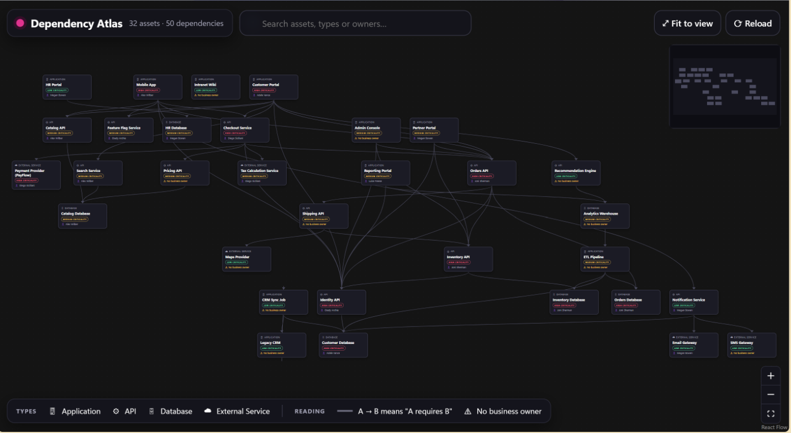
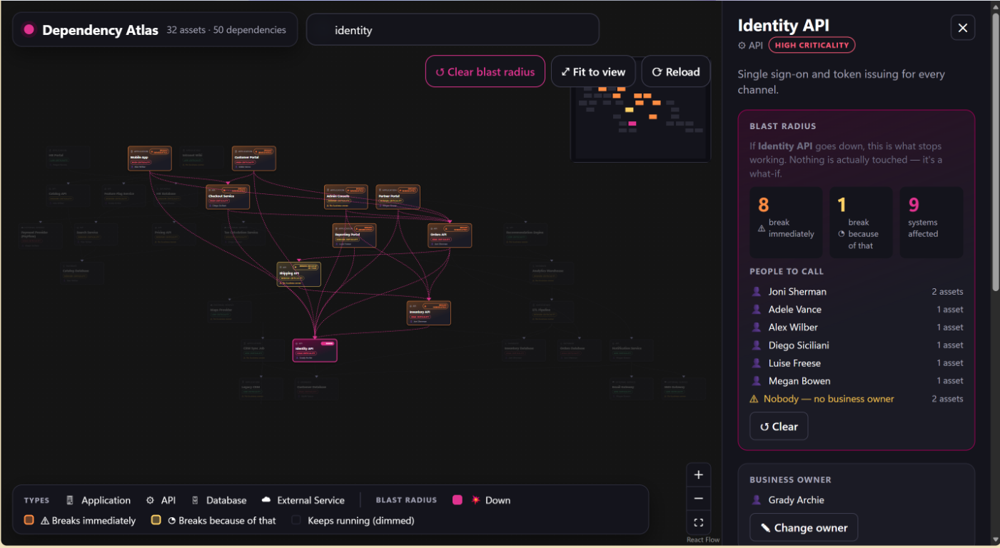
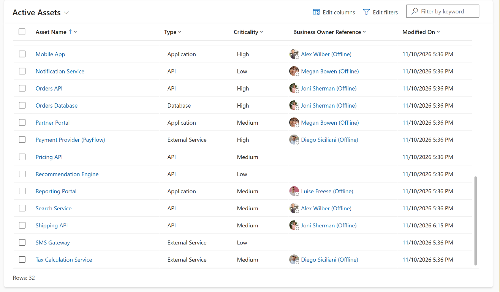

# Luise · 09:30–09:40 · walkthrough for Vesa

**What I built:** *Dependency Atlas* — a Power Apps **code app** (React) on Dataverse. A "what-could-possibly-go-wrong
graph" of an IT estate: pick a system, press **Show blast radius**, see what else breaks and who to call.
Plus a zero-code model-driven app on the same tables. Most of it was built with an AI assistant — that's the point of Q4.

**Please don't pre-empt my line** ("the future of low code is code") — I deliver it in Q1.

## What you'll see on screen

**The graph.** 32 systems of a fictional web shop (portals, APIs, databases, external services), 50 dependencies.
Each box shows type, name, criticality and business owner — ⚠ means nobody owns it. An arrow from A to B means
*A requires B*. This is the starting view for Q1.

**Blast radius.** Identity API (the login) is marked *down*. Orange boxes break immediately, the yellow one
(Shipping API) breaks a step later, everything else is dimmed. The panel on the right: **8 / 1 / 9 systems affected**
and **People to call** — six names, plus two systems where the answer is *nobody*. This is Q2.

**The same data, zero code.** A standard model-driven Power App on the same Asset table. In Q3 I set an owner in the
React app, refresh this grid, and it's there.

## The four questions (≈ 10 min, cumulative)

| | You ask | I show | I say |
| --- | --- | --- | --- |
| 0:30 | **How do you see Power Platform in the age of AI?** | The graph | • People think *low code + apps*; I think **data and platform**. The app on top is the least interesting part.  • **The future of low code is code** — this *is* a Power App, written in React. Same login, same governance. |
| 2:15 | **What can I actually ask it?** | Identity API → *Show blast radius* | • One question: *if this goes down, what else stops working?* Identity API = the login.  • **8 systems break immediately**, 1 more a step later: Shipping needs Inventory, Inventory needs Identity → **9 from one failure**.  • Every team knows its own needs; nobody knows the whole chain. The app does.  • **People to call**: six names — and two systems where the answer is *nobody*. |
| 4:15 | **Is that real data?** *(skip if over)* | Set an owner in React → refresh the model-driven app | • Two Dataverse tables.  • I set the Business Owner field here; it shows up in the other app immediately.  • **Same row, same table, two apps** — the React one is the app I wanted; the model-driven one the platform gives me for free. **That is data and platform.** |
| 5:15 | **Where's the AI in this — and where's the human?** *(the big one, 4 min)* | One Copilot prompt → new feature live · `npm run reset` running · the legend | • **AI wrote most of this app.** Here's one feature live — the prompt names the function to reuse and what the result should look like. *That* is the human part.  • Result: **Maps Provider — "low" criticality, no owner, 7 systems depend on it. Labels lie; graphs don't.**  • Where the human *really* is — **reproducible**: whole demo resets in 20 s, nobody inherits my mess.  • **Accessible**: words + icons, not red/green — 1 in 12 can't tell them apart, nor can the projector.  • **Governed**: an admin enabled it; it runs as the user. Admins keep the keys, developers get a better car.  • No prompt gives you those unless you insist. **AI builds the thing; humans decide what *right* looks like** — and that used to be the part we skipped.  • *Go find your Maps Provider.* |
| 9:30 | you wrap | | |

Rehearsal Wed: I want Q2 and Q4 once on the real projector. Live-coding fallback is a prepared branch — 10 s.
